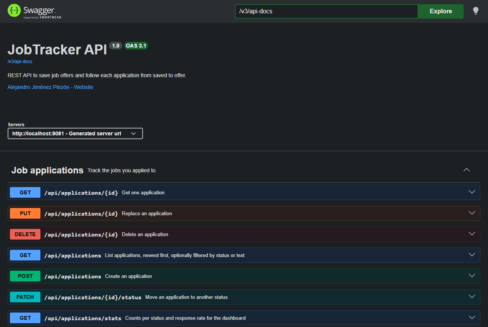

# JobTracker

Aplicación para organizar una búsqueda de empleo: guardas cada oferta, sigues en qué estado va (guardada → enviada → entrevista → oferta o rechazo) y ves tus estadísticas, como la tasa de respuesta.

La estoy construyendo por etapas mientras busco trabajo, así que también la uso de verdad.


## Hoja de ruta

| Etapa | Qué incluye | Estado |
|---|---|---|
| 1 | API REST con Spring Boot y PostgreSQL, validaciones, pruebas y documentación Swagger | ✅ Lista |
| 2 | Frontend en React: tablero Kanban y estadísticas | ⏳ Siguiente |
| 3 | Login con Spring Security y JWT; cada usuario ve solo sus postulaciones | Pendiente |
| 4 | Extensión de Chrome para guardar ofertas con un clic | Pendiente |
| 5 | IA que compara la hoja de vida con cada oferta | Pendiente |
| 6 | Integración continua con GitHub Actions y despliegue | Pendiente |

## API (etapa 1)



| Método | Ruta | Qué hace |
|---|---|---|
| `GET` | `/api/applications?status=&q=` | Lista las postulaciones, de la más nueva a la más antigua. Filtra por estado o por texto en empresa y cargo |
| `GET` | `/api/applications/{id}` | Devuelve una postulación |
| `POST` | `/api/applications` | Crea una postulación (`201` con cabecera `Location`) |
| `PUT` | `/api/applications/{id}` | Reemplaza una postulación |
| `PATCH` | `/api/applications/{id}/status` | Cambia solo el estado; es lo que usará el tablero al arrastrar una tarjeta |
| `DELETE` | `/api/applications/{id}` | Borra una postulación (`204`) |
| `GET` | `/api/applications/stats` | Totales por estado, postulaciones enviadas y tasa de respuesta |

**Decisiones técnicas:**
- **Paquetes por funcionalidad** (`jobapplication/`) en lugar de por capa, para tener junto todo lo de una misma funcionalidad.
- **DTOs con `record`**: la API nunca expone la entidad JPA directamente.
- **Flyway** crea y versiona el esquema; Hibernate solo valida que las entidades coincidan con él (`ddl-auto=validate`).
- **Errores con el formato estándar RFC 9457** (`ProblemDetail`). Los errores de validación incluyen un mapa `errors` (campo → mensaje) para que el frontend muestre cada mensaje bajo su campo.
- **Filtros combinables** con `Specification` de Spring Data JPA.
- **Pruebas de integración con Testcontainers**: corren contra un PostgreSQL real en Docker, la misma versión que en producción, no contra una base en memoria.

## Cómo ejecutarlo

Necesitas **Docker**. Desde la raíz del proyecto:

```bash
docker compose up --build
```

- API: http://localhost:8081
- Documentación interactiva (Swagger): http://localhost:8081/swagger-ui.html
- Estado del servicio: http://localhost:8081/actuator/health

La API usa el puerto 8081 porque en Windows el 8080 suele estar ocupado por XAMPP/Apache.

### Pruebas

```bash
cd backend
./mvnw test
```

Requieren Docker en marcha (Testcontainers levanta PostgreSQL por su cuenta).

## Estructura

```
jobtracker/
├── docker-compose.yml          ← PostgreSQL + API
└── backend/
    └── src/main/java/com/alejandrojimenez/jobtracker/
        ├── jobapplication/     ← entidad, repositorio, servicio, controlador y DTOs
        ├── common/             ← manejo global de errores
        └── config/             ← CORS y Swagger
```

## Autor

**Alejandro Jiménez Pinzón** · [Portafolio](https://alejandro-jimenez-portafolio.netlify.app/) · [LinkedIn](https://www.linkedin.com/in/alejandro-jimenez-pinzon/) · [GitHub](https://github.com/Alejo-developer)
